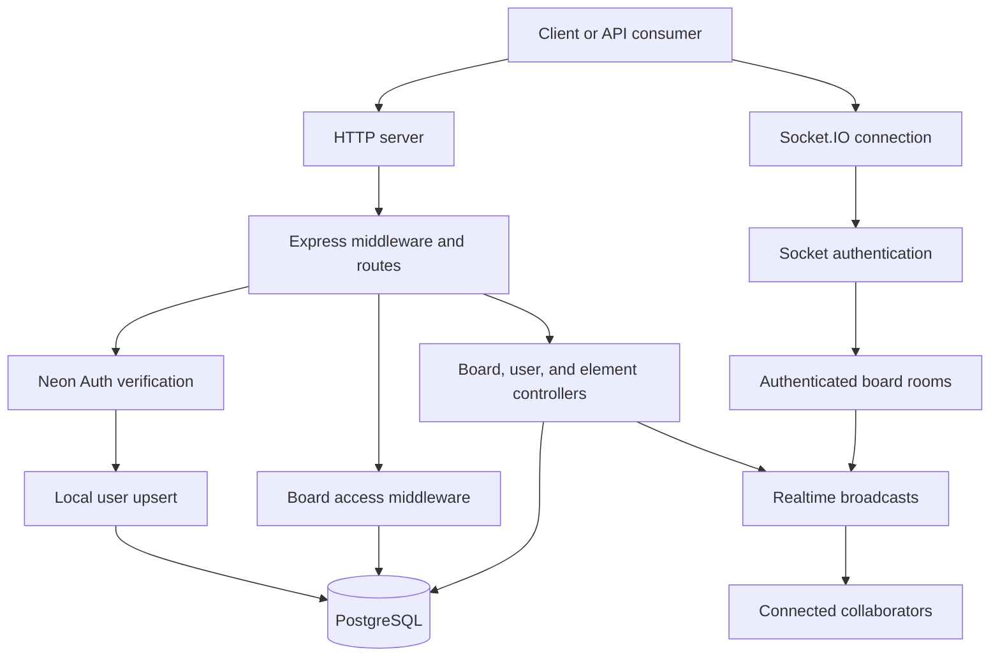
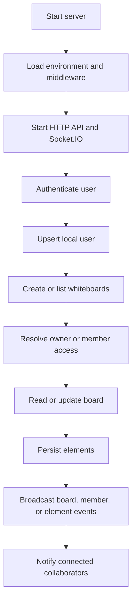

# AI Whiteboard Notes

Collaborative whiteboard notes platform with a Node.js/Express API, PostgreSQL persistence, Neon Auth authentication, and Socket.IO-based realtime collaboration.

> **Current repository scope:** The implemented and tracked application code is currently the backend in [`server/`](./server/). The [`client/`](./client/) directory exists, but no client application files are currently available in the repository. Frontend setup, screenshots, and a live demo are therefore marked as TODO rather than inferred.

## Project Overview

AI Whiteboard Notes provides the server-side foundation for collaborative whiteboards:

- Authenticated users are synchronized into a local PostgreSQL `users` table.
- Users can create, list, update, and delete whiteboards.
- Whiteboards can be shared with `editor` or `viewer` members.
- Boards contain typed, JSON-backed visual elements.
- REST endpoints persist element creation, updates, deletion, and bulk creation.
- Socket.IO provides authenticated board rooms, presence, cursor updates, and live element events.

The backend is organized as a standalone Node.js service and can be run independently of the currently empty client directory.

## Problem Statement & Objectives

Traditional whiteboard notes are difficult to organize, share, and update collaboratively. This project is intended to provide a structured, persistent workspace where users can:

1. Manage multiple whiteboards.
2. Store canvas elements in a durable database.
3. Collaborate with role-based access control.
4. Receive realtime presence and canvas updates.
5. Extend the platform with AI-assisted notes and visual understanding in future iterations.

The current implementation focuses on the authenticated API, persistence model, and realtime server foundation. AI generation and frontend workflows are not currently exposed by the tracked server code.

## Key Features

### Implemented

- Express HTTP API.
- PostgreSQL connection pooling through `pg`.
- Neon Auth JWT/session verification.
- Local user upsert on authenticated requests.
- User search by name or email.
- Whiteboard creation and listing.
- Whiteboard metadata updates.
- Owner-only board deletion.
- Board membership management.
- `owner`, `editor`, and `viewer` access roles.
- Element creation, update, deletion, and bulk creation.
- JSONB element data with z-order values.
- Socket.IO authentication and board rooms.
- Presence join, sync, leave, and disconnect events.
- Cursor presence events.
- Live, non-persistent element events.
- REST-to-Socket.IO broadcasts for board, member, and element changes.
- Database schema initialization through `npm run db:init`.

### Current limitations

- No client implementation is currently tracked in `client/`.
- No live deployment URL is configured in the repository.
- No automated test files or test script are currently present.
- Element persistence currently contains a known table-name mismatch: `touchBoard()` updates `boards`, while the schema defines `whiteboards`. See [`server/Flow/02-element-flow.md`](./server/Flow/02-element-flow.md).
- AI, file upload, S3, and Google GenAI packages appear in the server manifest, but no corresponding active route or service is currently present in the tracked source.

## Screenshots & Live Demo

### Screenshots

TODO: Add application screenshots after the client interface is available.

Suggested future screenshots:

- Board dashboard
- Whiteboard canvas
- Collaboration/member management
- Realtime presence indicators

### Live demo

TODO: Add the deployed application URL and API URL.

## Tech Stack

| Layer | Technology | Evidence |
|---|---|---|
| Runtime | Node.js | `server/package.json` |
| HTTP API | Express 4 | `server/package.json` |
| Database | PostgreSQL | `pg` dependency and `server/src/db/schema.sql` |
| Database client | `pg` connection pool | `server/src/config/db.js` |
| Authentication | Neon Auth + `jose` | `server/src/config/neonAuth.js` |
| Realtime | Socket.IO | `server/src/socket/index.js` |
| Configuration | `dotenv` | `server/index.js`, `server/src/db/init.js` |
| Cross-origin requests | `cors` | `server/index.js` |

The repository does not currently contain a frontend package manifest, so no frontend framework is claimed here.

## System Architecture

At a high level, the server combines REST and Socket.IO on one HTTP server:



### Main server layers

| Layer | Location | Responsibility |
|---|---|---|
| Entrypoint | [`server/index.js`](./server/index.js) | Express setup, HTTP server, Socket.IO initialization, listening |
| Routes | [`server/src/routes/`](./server/src/routes/) | HTTP route registration |
| Middleware | [`server/src/middleware/`](./server/src/middleware/) | Authentication, board access, errors |
| Controllers | [`server/src/controllers/`](./server/src/controllers/) | Request validation, database operations, responses |
| Database | [`server/src/db/`](./server/src/db/) | Schema and initialization |
| Configuration | [`server/src/config/`](./server/src/config/) | PostgreSQL and Neon Auth configuration |
| Realtime | [`server/src/realtime/`](./server/src/realtime/) | Room naming and controller broadcasts |
| Socket handlers | [`server/src/socket/`](./server/src/socket/) | Socket authentication, rooms, presence, live events |
| Utilities | [`server/src/utils/`](./server/src/utils/) | User resolution, API errors, async error forwarding |

## Architecture & Technical Documentation

The detailed technical reference is intentionally kept in the existing [`server/Flow/`](./server/Flow/) documentation. These files contain the full request traces, SQL operations, diagrams, event flows, and known implementation notes.

| Document | What it covers |
|---|---|
| [`server/Flow/README.md`](./server/Flow/README.md) | Documentation index plus end-to-end HTTP and Socket.IO diagrams |
| [`server/Flow/01-server-and-rest-flow.md`](./server/Flow/01-server-and-rest-flow.md) | Server startup, REST pipeline, authentication, authorization, route map, board operations, and errors |
| [`server/Flow/02-element-flow.md`](./server/Flow/02-element-flow.md) | Element validation, single and bulk persistence, response behavior, broadcasts, and the `boards`/`whiteboards` issue |
| [`server/Flow/03-realtime-flow.md`](./server/Flow/03-realtime-flow.md) | Socket authentication, board access checks, rooms, presence, cursors, live elements, disconnects, and REST broadcasts |
| [`server/Flow/04-database-operations.md`](./server/Flow/04-database-operations.md) | PostgreSQL schema, entity relationships, indexes, SQL inventory, cascades, and transaction notes |

Use the flow documents as the source of truth for implementation-level behavior instead of duplicating those details here.

## Project Folder Structure

```text
AIWhiteboardNote/
├── client/                         # Present directory; client implementation TODO
├── server/
│   ├── index.js                    # HTTP and Socket.IO entrypoint
│   ├── package.json                # Backend scripts and dependencies
│   ├── package-lock.json
│   ├── Flow/                       # Detailed server flow documentation
│   └── src/
│       ├── config/                 # Database and Neon Auth configuration
│       ├── controllers/            # User, board, and element controllers
│       ├── db/                     # PostgreSQL schema and initialization
│       ├── middleware/             # Auth, access, and error middleware
│       ├── realtime/               # Socket.IO broadcast helper
│       ├── routes/                 # API route registration
│       ├── socket/                 # Socket.IO server and event handlers
│       └── utils/                  # Errors, async handling, user resolution
├── .gitignore
└── README.md
```

## Prerequisites

- Node.js compatible with the installed project dependencies.
- npm.
- PostgreSQL database, preferably a Neon PostgreSQL database for the intended deployment setup.
- A Neon Auth project and a token/session issuer for protected routes.
- A terminal capable of running the commands below.

The exact Node.js version is not pinned in the repository. TODO: add an `.nvmrc` or `engines` field when the supported version is standardized.

## Installation & Setup

Clone the repository and enter the backend directory:

```bash
git clone <repository-url>
cd AIWhiteboardNote/server
npm install
```

Create a local `.env` file in `server/` using the variables listed below. Do not commit it; `.env` is ignored by the repository.

Initialize the database schema:

```bash
npm run db:init
```

The schema initializer creates the `pgcrypto` extension, application tables, foreign keys, and indexes defined in [`server/src/db/schema.sql`](./server/src/db/schema.sql).

## Environment Variables

| Variable | Required | Default | Description |
|---|---:|---|---|
| `DATABASE_URL` | Yes | None | PostgreSQL connection string used by `pg` |
| `NEON_AUTH_URL` | Yes for protected routes | None | Neon Auth base URL used for JWKS/session verification |
| `CLIENT_URL` | No | `http://localhost:5173` | Allowed CORS origin for HTTP and Socket.IO |
| `PORT` | No | `5050` | HTTP and Socket.IO listening port |

Example:

```env
DATABASE_URL=postgresql://<user>:<password>@<host>/<database>?sslmode=require
NEON_AUTH_URL=https://<your-neon-auth-url>
CLIENT_URL=http://localhost:5173
PORT=5050
```

Use actual values from your environment. Never commit credentials or tokens.

## Running the Project

From `server/`:

```bash
# Start the API and Socket.IO server
npm start

# Start with nodemon during development
npm run dev
```

When running locally:

- API base URL: `http://localhost:5050`
- Root status endpoint: `http://localhost:5050/`
- Health endpoint: `http://localhost:5050/api/health`
- Socket.IO endpoint: same host and port as the API

Verify the server without authentication:

```bash
curl http://localhost:5050/
curl http://localhost:5050/api/health
```

Expected status responses:

```json
{ "name": "AI Whiteboard Notes API", "version": "1.0.0", "status": "running" }
```

```json
{ "status": "ok" }
```

Protected endpoints require:

```text
Authorization: Bearer <neon-auth-token>
```

## API Documentation

The API is mounted below `/api`.

### Public endpoints

| Method | Endpoint | Purpose |
|---|---|---|
| GET | `/` | API status |
| GET | `/api/health` | Health check |

### Authenticated user endpoints

| Method | Endpoint | Purpose |
|---|---|---|
| GET | `/api/users/search?q=<text>` | Search up to ten users by name or email |

### Authenticated whiteboard endpoints

| Method | Endpoint | Purpose |
|---|---|---|
| GET | `/api/whiteboards` | List owned and shared boards |
| POST | `/api/whiteboards` | Create a board |
| GET | `/api/whiteboards/:boardId` | Read board, elements, and members |
| PATCH | `/api/whiteboards/:boardId` | Update board metadata |
| DELETE | `/api/whiteboards/:boardId` | Delete a board; owner only |
| POST | `/api/whiteboards/:boardId/members` | Add or update a member; owner only |
| DELETE | `/api/whiteboards/:boardId/members/:userId` | Remove a member; owner only |
| POST | `/api/whiteboards/:boardId/elements` | Create one element |
| POST | `/api/whiteboards/:boardId/elements/bulk` | Create multiple elements |
| PATCH | `/api/whiteboards/:boardId/elements/:elementId` | Update element data or z-order |
| DELETE | `/api/whiteboards/:boardId/elements/:elementId` | Delete an element |

For validation rules, SQL, response shapes, access behavior, and realtime side effects, see:

- [`01-server-and-rest-flow.md`](./server/Flow/01-server-and-rest-flow.md)
- [`02-element-flow.md`](./server/Flow/02-element-flow.md)
- [`03-realtime-flow.md`](./server/Flow/03-realtime-flow.md)

## Database Overview

The PostgreSQL schema contains four core tables:

| Table | Purpose |
|---|---|
| `users` | Local user identity synchronized from Neon Auth |
| `whiteboards` | Board metadata and ownership |
| `whiteboard_members` | Board membership and `editor`/`viewer` roles |
| `elements` | Board visual elements stored as JSONB data |

Key relationships:

- A user owns many whiteboards.
- A whiteboard has many members and elements.
- Board deletion cascades to members and elements.
- User deletion cascades to owned boards and memberships.
- Element `created_by` is set to `NULL` when its creator is deleted.

For the complete schema, indexes, SQL inventory, foreign-key behavior, and consistency notes, see [`server/Flow/04-database-operations.md`](./server/Flow/04-database-operations.md).

## Authentication & Authorization

### Authentication

Protected HTTP routes require a bearer token. Neon Auth verifies JWTs through its JWKS endpoint or resolves a session for non-JWT tokens. The server then upserts the authenticated user into PostgreSQL and attaches the local user to the request.

Socket.IO clients authenticate through `handshake.auth.token`. The same user-resolution process is used before the connection is accepted.

### Authorization

Board access is role-based:

| Role | Read board | Edit board/elements | Delete/manage members |
|---|---:|---:|---:|
| Owner | Yes | Yes | Yes |
| Editor | Yes | Yes | No |
| Viewer | Yes | No | No |

HTTP board access checks query the board owner and membership table. Socket clients must pass an owner/member check before joining a board room.

See [`server/Flow/01-server-and-rest-flow.md`](./server/Flow/01-server-and-rest-flow.md) and [`server/Flow/03-realtime-flow.md`](./server/Flow/03-realtime-flow.md) for the full authentication and authorization flows.

## Application Workflow



Typical user flow:

1. Start the server and database.
2. Authenticate with Neon Auth.
3. Make an authenticated request; the user is synchronized locally.
4. Create or list accessible whiteboards.
5. Open a board and join its Socket.IO room.
6. Read existing elements over REST.
7. Persist element changes through REST.
8. Receive realtime updates from other collaborators.

## Testing

There are currently no test files or test script in `server/package.json`.

Available verification commands:

```bash
cd server
npm run db:init
npm start
```

Then check the public endpoints:

```bash
curl http://localhost:5050/
curl http://localhost:5050/api/health
```

TODO: Add automated unit, API integration, database, and Socket.IO collaboration tests.

## Deployment

The server is a conventional Node.js service and can be deployed to a Node-compatible hosting platform with:

1. `server/` as the application directory.
2. `npm install` during build/install.
3. `npm run db:init` against the target PostgreSQL database as a controlled migration/setup step.
4. `npm start` as the process command.
5. `DATABASE_URL`, `NEON_AUTH_URL`, `CLIENT_URL`, and `PORT` configured as platform secrets/environment variables.
6. WebSocket support enabled by the hosting platform.

Deployment provider, domain, CI/CD workflow, and production migration strategy are not defined in the repository. TODO: document the chosen deployment target and production database migration process.

Before production deployment, review:

- PostgreSQL SSL configuration.
- CORS origin restrictions.
- Secret management.
- Socket.IO WebSocket/proxy support.
- The element `touchBoard()` table-name mismatch documented in [`server/Flow/02-element-flow.md`](./server/Flow/02-element-flow.md).

## Future Improvements

The following are proposed improvements, not currently implemented features:

- Add and integrate the frontend client.
- Add AI-assisted whiteboard note generation and summaries.
- Resolve the `boards` versus `whiteboards` update mismatch.
- Wrap multi-step element operations in transactions where atomicity is required.
- Add automated unit and integration test coverage.
- Add API schema/OpenAPI documentation.
- Add structured logging and production observability.
- Add database migrations instead of executing the complete schema script for setup.
- Add rate limiting and additional request validation.
- Add board deletion and membership-change realtime events where needed.
- Add CI/CD and documented deployment environments.