# Server and REST Flow

## 1. Startup

The server starts in [`../index.js`](../index.js):

1. `dotenv` loads environment variables.
2. Express is created.
3. CORS allows `CLIENT_URL`, defaulting to `http://localhost:5173`, with credentials.
4. JSON parsing accepts request bodies up to `5mb`.
5. `/uploads` serves locally stored uploads from the upload directory with a 30-day immutable cache policy.
6. `GET /` returns API status.
7. `/api` is mounted from [`../src/routes/index.js`](../src/routes/index.js).
8. 404 and error middleware are registered.
9. `http.createServer(app)` creates the HTTP server.
10. `initSocket(server)` attaches Socket.IO.
11. The combined API and Socket.IO server listens on `PORT`, default `5050`.

The database pool is created by [`../src/config/db.js`](../src/config/db.js) when imported. Schema initialization is separate and runs through `npm run db:init`.

## 2. Request pipeline

```mermaid
flowchart LR
    REQ["HTTP request"] --> CORS["CORS"]
    CORS --> JSON["express.json 5 MB"]
    JSON --> API["/api"]
    API --> AUTH{"Protected route?"}
    AUTH -- "No" --> CTRL["Controller"]
    AUTH -- "Yes" --> BEARER["Read Bearer token"]
    BEARER --> NEON["Neon Auth verify"]
    NEON --> UPSERT["Upsert local user"]
    UPSERT --> USER["req.user"]
    USER --> BOARD{"Board-specific?"}
    BOARD -- "No" --> CTRL
    BOARD -- "Yes" --> ACCESS["Board access query"]
    ACCESS --> BOARDCTX["req.board"]
    BOARDCTX --> CTRL{"Board, upload, or element controller"}
    CTRL --> UPLOAD{"Upload route?"}
    UPLOAD -- "Yes" --> MULTER["Multer image validation"]
    MULTER --> STORE["S3 object storage or local disk"]
    STORE --> URL["Image URL"]
    UPLOAD -- "No" --> MUTATION["Board or element operation"]
    MUTATION --> QUERY[("PostgreSQL")]
    MUTATION --> RT["Realtime broadcast"]
    RT --> S["Socket.IO room"]
    URL --> RESPONSE["JSON response"]
    QUERY --> RESPONSE
    S --> RESPONSE
    CTRL --> ERR["asyncHandler -> errorHandler"]
```



All async handlers use [`../src/utils/asyncHandler.js`](../src/utils/asyncHandler.js), which forwards rejected promises to the centralized error handler.

## 3. Authentication

[`../src/middleware/auth.js`](../src/middleware/auth.js) requires `Authorization: Bearer <token>`.

[`../src/config/neonAuth.js`](../src/config/neonAuth.js) verifies JWTs with Neon Auth JWKS. Non-JWT tokens use the Neon Auth session endpoint. [`../src/utils/resolveUser.js`](../src/utils/resolveUser.js) normalizes the email/name and executes:

```sql
INSERT INTO users (name, email)
VALUES ($1, $2)
ON CONFLICT (email) DO UPDATE SET name = EXCLUDED.name
RETURNING id, email, name;
```

The resulting local record is attached as:

```js
req.user = { id, email, name };
```

Failures:

- Missing bearer token: `401 Missing authentication token`
- Invalid/expired token: `401 Invalid or expired token`
- Missing email claim: `401 Neon Auth session has no email`

## 4. Route map

| Method | Path | Middleware | Handler |
|---|---|---|---|
| GET | `/` | None | API status |
| GET | `/api/health` | None | Health status |
| GET | `/api/users/search?q=...` | `requireAuth` | User search |
| GET | `/api/whiteboards` | `requireAuth` | List accessible boards |
| POST | `/api/whiteboards` | `requireAuth` | Create board |
| GET | `/api/whiteboards/:boardId` | Auth + board access | Read board |
| PATCH | `/api/whiteboards/:boardId` | Auth + board access + edit access | Update board |
| DELETE | `/api/whiteboards/:boardId` | Auth + board access | Delete board, owner only |
| POST | `/api/whiteboards/:boardId/members` | Auth + board access | Add/update member, owner only |
| DELETE | `/api/whiteboards/:boardId/members/:userId` | Auth + board access | Remove member, owner only |
| POST | `/api/whiteboards/:boardId/upload` | Auth + board access + edit access + image upload | Upload an image |
| POST | `/api/whiteboards/:boardId/elements` | Auth + board access + edit access | Create element |
| POST | `/api/whiteboards/:boardId/elements/bulk` | Auth + board access + edit access | Create multiple elements |
| PATCH | `/api/whiteboards/:boardId/elements/:elementId` | Auth + board access + edit access | Update element |
| DELETE | `/api/whiteboards/:boardId/elements/:elementId` | Auth + board access + edit access | Delete element |

Element endpoints are detailed in [`02-element-flow.md`](./02-element-flow.md).

## 5. Image upload

Route:

```text
POST /api/whiteboards/:boardId/upload
```

The request must be authenticated, the user must have board access, and the user must have edit access. The upload middleware expects a `multipart/form-data` request with one file in the `image` field.

The pipeline is:

1. `requireAuth` resolves the authenticated user.
2. `requireBoardAccess` verifies that the board exists and the user is an owner or member.
3. `requireEditAccess` rejects viewers with `403`.
4. Multer stores the file in memory, accepts only MIME types beginning with `image/`, and limits the file to `8 MB`.
5. The controller generates a timestamp-plus-random filename and maps supported image MIME types to extensions.
6. If all object-storage settings are configured, the buffer is uploaded to the `whiteboards/<filename>` S3 key.
7. Otherwise, the buffer is written to the local `uploads` directory and exposed through `/uploads/<filename>`.
8. The controller returns status `201`:

```json
{
  "url": "https://...",
  "filename": "1760000000000-a1b2c3d4e5f6.png",
  "size": 12345
}
```

The upload does not create a PostgreSQL row and does not emit a Socket.IO event. The returned URL can be placed in the data for an `image` whiteboard element, which can then be persisted through the element endpoint.

Upload failures include:

- `400 No image file provided` when the `image` field is missing.
- `400 Only image files can be uploaded` when the MIME type is not an image.
- `400 File size is too large (max 8 MB)` when Multer rejects the file size.

## 6. Board authorization

[`../src/middleware/whiteboardAccess.js`](../src/middleware/whiteboardAccess.js) reads a board ID from route params, body, or query and executes:

```sql
SELECT b.id, b.owner_id, m.role
FROM whiteboards b
LEFT JOIN whiteboard_members m
  ON m.whiteboard_id = b.id AND m.user_id = $2
WHERE b.id = $1;
```

It attaches `req.board = { id, owner_id, role }`.

| Effective role | Read | Edit | Delete/manage members |
|---|---:|---:|---:|
| `owner` | Yes | Yes | Yes |
| `editor` | Yes | Yes | No |
| `viewer` | Yes | No | No |

Missing board ID is `400`; missing board is `404`; unauthorized access is `403`.

## 7. User search

`GET /api/users/search` returns an empty list without querying when `q` has fewer than two characters. Otherwise:

```sql
SELECT id, name, email, avatar_url
FROM users
WHERE name ILIKE $1 OR email ILIKE $1
ORDER BY name ASC
LIMIT 10;
```

Response: `{ "user": [...] }`.

## 8. Board operations

### List boards

The list query joins memberships and aggregates element counts:

```sql
SELECT b.id, b.title, b.description, b.background, b.bg_color,
       b.owner_id, b.created_at, b.updated_at,
       (b.owner_id = $1) AS is_owner,
       COALESCE(cnt.n, 0)::int AS element_count
FROM whiteboards b
LEFT JOIN whiteboard_members m
  ON m.whiteboard_id = b.id AND m.user_id = $1
LEFT JOIN (
  SELECT whiteboard_id, COUNT(*) AS n
  FROM elements
  GROUP BY whiteboard_id
) cnt ON cnt.whiteboard_id = b.id
WHERE b.owner_id = $1 OR m.user_id = $1
ORDER BY b.updated_at DESC;
```

Response: `{ "boards": [...] }`.

### Create board

Input defaults:

- title: `Untitled whiteboard`
- description: `NULL`
- background: `dots`
- bg_color: `#ffffff`

```sql
INSERT INTO whiteboards
  (title, description, background, bg_color, owner_id)
VALUES ($1, $2, $3, $4, $5)
RETURNING *;
```

Response status: `201`, body `{ "board": {...} }`.

### Read board

After authorization, three queries run concurrently:

```sql
SELECT * FROM whiteboards WHERE id = $1;

SELECT id, type, data, z, created_by, updated_at
FROM elements
WHERE whiteboard_id = $1
ORDER BY z ASC;
```

The members query returns the owner as role `owner` and all `whiteboard_members` rows. Response:

```json
{ "board": {}, "elements": [], "members": [] }
```

### Update board

Validated fields are dynamically parameterized. `updated_at` is always set:

```sql
UPDATE whiteboards
SET <validated fields>, updated_at = now()
WHERE id = $N
RETURNING *;
```

After success, `board:updated` is emitted to the board room.

### Delete board

Only owners may delete:

```sql
DELETE FROM whiteboards WHERE id = $1;
```

Foreign keys cascade to members and elements. Response: `{ "success": true }`.

### Manage members

Invitee lookup:

```sql
SELECT id, name, email, avatar_url
FROM users
WHERE LOWER(email) = $1;
```

Insert or role update:

```sql
INSERT INTO whiteboard_members (whiteboard_id, user_id, role)
VALUES ($1, $2, $3)
ON CONFLICT (whiteboard_id, user_id)
DO UPDATE SET role = EXCLUDED.role;
```

Removal:

```sql
DELETE FROM whiteboard_members
WHERE whiteboard_id = $1 AND user_id = $2;
```

Member changes emit `member:added` or `member:removed`.

## 9. Error handling

[`../src/middleware/errorHandler.js`](../src/middleware/errorHandler.js) maps:

- PostgreSQL `23505` to HTTP `409`.
- Multer errors to HTTP `400`.
- `ApiError.statusCode` to its status.
- Unknown errors to HTTP `500` with a generic message.
- Unknown routes to HTTP `404`.
