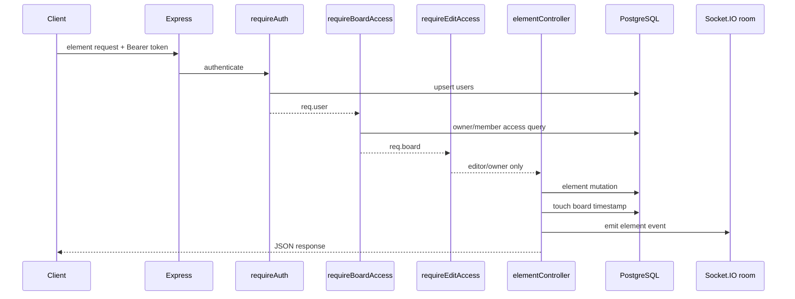

# Element Flow

Element routes are registered in [`../src/routes/whiteboardRoutes.js`](../src/routes/whiteboardRoutes.js) and implemented in [`../src/controllers/elementController.js`](../src/controllers/elementController.js).

## 1. Common request pipeline



All element routes require board access and edit access. Viewers receive `403`.

## 2. Valid element types

The controller accepts:

```text
text, sticky, rect, ellipse, diamond, line, arrow,
image, bullet, draw, emoji, chart
```

`data` must be an object; otherwise create operations use `{}` and update operations return `400`. `z` uses the supplied finite number or defaults to `1000`.

## 3. Create one element

Route:

```text
POST /api/whiteboards/:boardId/elements
```

Validation:

1. `type` must be in `VALID_TYPES`.
2. `data` is normalized to an object.
3. `z` is normalized to a finite number or `1000`.

Database operation:

```sql
INSERT INTO elements
  (whiteboard_id, type, data, z, created_by)
VALUES ($1, $2, $3, $4, $5)
RETURNING id, type, data, z, created_at, updated_at;
```

Parameters are board ID, type, JSON-stringified data, z, and authenticated user ID.

Then the controller calls `touchBoard(boardId)`, emits `element:created` excluding the optional `x-socket-id`, and returns:

```json
{
  "element": {
    "id": "uuid",
    "type": "sticky",
    "data": {},
    "z": 1000,
    "created_at": "...",
    "updated_at": "..."
  }
}
```

Status: `201`.

## 4. Update one element

Route:

```text
PATCH /api/whiteboards/:boardId/elements/:elementId
```

Supported fields:

- `data`: must be an object.
- `z`: must be finite.

The controller rejects an empty/invalid update with `400`.

```sql
UPDATE elements
SET <validated fields>, updated_at = now()
WHERE id = $1 AND whiteboard_id = $2
RETURNING id, type, data, z, created_by, updated_at;
```

The board ID condition prevents editing an element belonging to another board. Missing rows return `404 Element not found`.

Then `touchBoard()` runs, `element:updated` is emitted, and the response is `{ "element": {...} }`.

## 5. Delete one element

Route:

```text
DELETE /api/whiteboards/:boardId/elements/:elementId
```

```sql
DELETE FROM elements
WHERE id = $1 AND whiteboard_id = $2
RETURNING type, data;
```

Missing rows return `404 Element not found`. On success, the board timestamp is touched, `element:deleted` is emitted with `{ id }`, and the response is `{ "success": true }`.

## 6. Bulk create

Route:

```text
POST /api/whiteboards/:boardId/elements/bulk
```

The controller:

1. Reads `req.body.elements`.
2. Uses an empty list if it is not an array.
3. Filters out entries whose type is not valid.
4. Returns `400 No valid elements to create` if nothing remains.
5. Inserts valid elements one by one.
6. Touches the board once.
7. Emits `element:created` once per created element.
8. Returns status `201`.

Each item uses:

```sql
INSERT INTO elements
  (whiteboard_id, type, data, z, created_by)
VALUES ($1, $2, $3, $4, $5)
RETURNING id, type, data, z, created_by, updated_at;
```

Response:

```json
{
  "elements": []
}
```

The inserts are not wrapped in a transaction. If a later insert fails, earlier inserts remain committed.

## 7. Current database mismatch

The controller currently defines:

```js
const touchBoard = (boardId) =>
    query('UPDATE boards SET updated_at = NOW() WHERE id = $1', [boardId]);
```

The schema defines `whiteboards`, not `boards`:

```sql
CREATE TABLE IF NOT EXISTS whiteboards (...);
```

Therefore:

```text
element INSERT/UPDATE/DELETE
        |
        +--> mutation may complete
        |
        +--> UPDATE boards ...
                |
                +--> PostgreSQL relation "boards" does not exist
                |
                +--> request fails before response/broadcast
```

This affects all four element operations after their primary mutation. It also means the mutation and timestamp update are not atomic. The intended operation is most likely:

```sql
UPDATE whiteboards
SET updated_at = NOW()
WHERE id = $1;
```

This document records the mismatch; it does not change application code.
