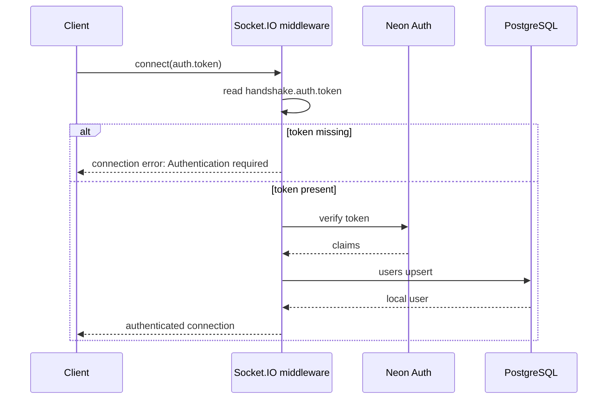
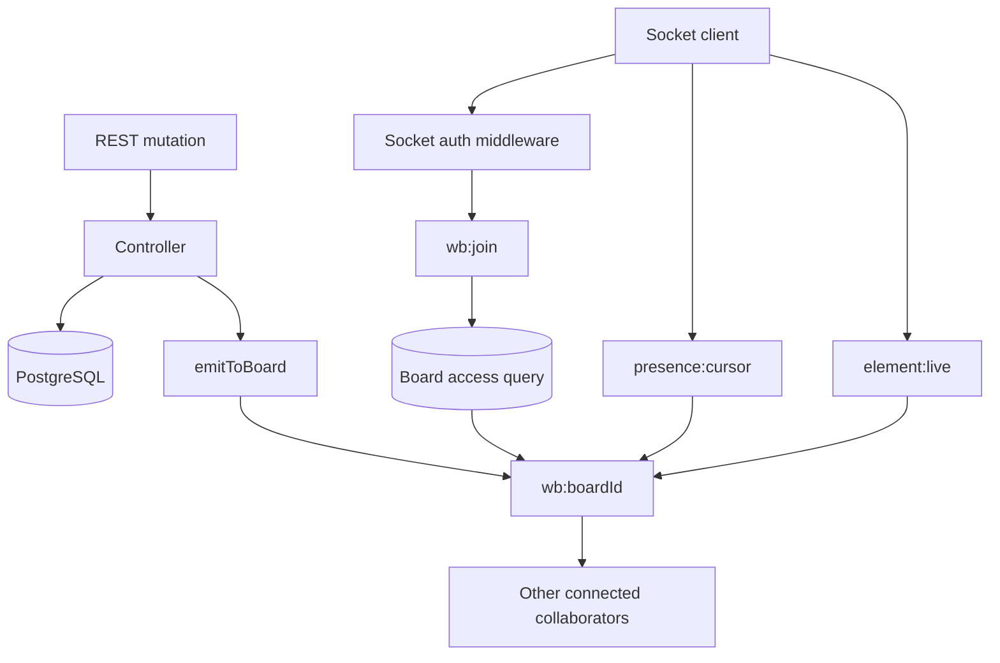

# Realtime Flow

## 1. Initialization

[`../index.js`](../index.js) creates an HTTP server and passes it to `initSocket`:

```js
const server = http.createServer(app);
initSocket(server);
server.listen(PORT);
```

[`../src/socket/index.js`](../src/socket/index.js) creates Socket.IO with the same CORS origin and credentials policy as Express. It then calls `setIo(io)` in [`../src/realtime/index.js`](../src/realtime/index.js), allowing REST controllers to emit to rooms.

## 2. Socket authentication



The socket stores the normalized local user on both `socket.user` and `socket.data.user`.

## 3. Board access for socket joins

For `wb:join`, the server executes:

```sql
SELECT 1
FROM whiteboards b
LEFT JOIN whiteboard_members m
  ON m.whiteboard_id = b.id
WHERE b.id = $1
  AND (b.owner_id = $2 OR m.user_id = $2)
LIMIT 1;
```

The user must own the board or have a membership row. Role is not needed for joining; viewers can join and receive read/presence events.

## 4. Room naming

[`../src/realtime/index.js`](../src/realtime/index.js) maps a board ID to:

```text
wb:<boardId>
```

Each socket also has its private Socket.IO room identified by its socket ID.

## 5. `wb:join`

Client sends:

```js
socket.emit("wb:join", boardId, ack);
```

Flow:

1. Validate that `boardId` is a string.
2. Check owner/member access in PostgreSQL.
3. Join `wb:<boardId>`.
4. If this socket was not already in the room, broadcast `presence:join` to other members.
5. Fetch all sockets in the room.
6. Deduplicate users across multiple tabs.
7. Send `presence:sync` to the joining socket.
8. Acknowledge `{ ok: true }`.

Failed joins acknowledge `{ ok: false, error: ... }`.

## 6. `wb:leave`

The server validates the board ID, verifies that the socket is in the room, leaves it, and broadcasts:

```json
{
  "user": { "id": "...", "name": "..." },
  "boardId": "..."
}
```

Event: `presence:leave`.

## 7. Cursor presence

Client event:

```js
socket.emit("presence:cursor", { boardId, x, y });
```

The server requires string `boardId`, finite numeric `x` and `y`, and membership in the board room. It forwards `presence:cursor` to other room members with the sender's user identity.

## 8. Live element presence

Client event:

```js
socket.emit("element:live", boardId, element);
```

The server requires a valid board ID, an object element, and room membership. It broadcasts:

```json
{
  "element": {},
  "by": "user-uuid"
}
```

Event: `element:live`. This event does not write to PostgreSQL; persistent element writes use the REST endpoints.

## 9. Disconnect

During `disconnecting`, every joined board room receives `presence:leave`. The private socket room is skipped. A final `disconnect` log records the reason.

## 10. REST-to-realtime events

REST controllers call `emitToBoard(boardId, event, payload, exceptSocketId)`:

| REST operation | Event | Sender exclusion |
|---|---|---|
| Board metadata update | `board:updated` | `x-socket-id` |
| Member add or role update | `member:added` | None |
| Member removal | `member:removed` | None |
| Element create | `element:created` | `x-socket-id` |
| Element update | `element:updated` | `x-socket-id` |
| Element delete | `element:deleted` | `x-socket-id` |

If Socket.IO has not been initialized, `emitToBoard` returns without emitting. In the current `index.js`, initialization is wired.

Image uploads use `POST /api/whiteboards/:boardId/upload` and are intentionally not part of the realtime event flow. The upload endpoint stores the image in object storage or local disk and returns its URL; the client can then persist an `image` element through the normal element REST endpoint, which emits `element:created`.

## 11. Realtime architecture



## 12. Current element broadcast caveat

Element REST operations call `touchBoard()` before emitting. Because `touchBoard()` currently targets the nonexistent `boards` table, the request can fail before the corresponding `element:*` event is emitted. See [`02-element-flow.md`](./02-element-flow.md).
