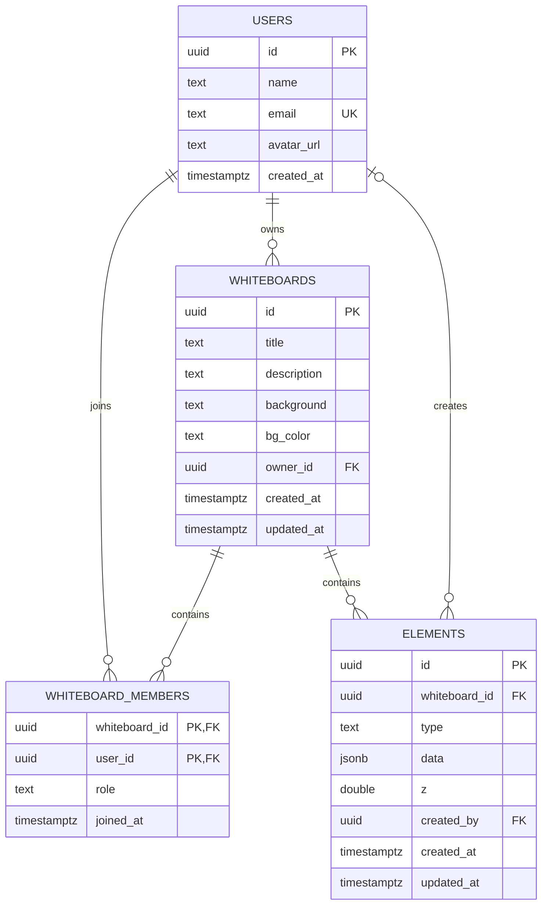
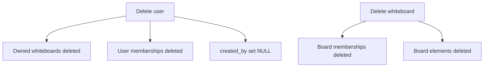

# Database Operations

## 1. Connection and execution

[`../src/config/db.js`](../src/config/db.js) creates a `pg.Pool` using `DATABASE_URL` with:

- maximum 10 connections
- 30-second idle timeout
- 10-second connection timeout
- SSL enabled with `rejectUnauthorized: false`

Most server operations call `query(text, params)`. [`withTransaction`](../src/config/db.js) supports `BEGIN`, `COMMIT`, and `ROLLBACK`, but no current controller uses it.

## 2. Schema creation

[`../src/db/init.js`](../src/db/init.js), run by `npm run db:init`, reads and executes [`../src/db/schema.sql`](../src/db/schema.sql).

```sql
CREATE EXTENSION IF NOT EXISTS "pgcrypto";
```

All tables and indexes use `IF NOT EXISTS`.

## 3. Tables and relationships



## 4. Table definitions

### `users`

`id` is generated UUID primary key. `email` is unique and required. `name` is required. `avatar_url` is optional.

### `whiteboards`

`owner_id` references `users(id)` with `ON DELETE CASCADE`. `background` defaults to `dots`; `bg_color` defaults to `#ffffff`. Creation and update timestamps default to `now()`.

### `whiteboard_members`

The composite primary key `(whiteboard_id, user_id)` prevents duplicate memberships. Both foreign keys cascade when the board or user is deleted. `role` defaults to `editor`.

### `elements`

`whiteboard_id` cascades on board deletion. `created_by` uses `ON DELETE SET NULL`. `data` defaults to an empty JSON object and `z` defaults to `1000`.

## 5. Indexes

```sql
CREATE INDEX IF NOT EXISTS idx_whiteboard_owner
  ON whiteboards(owner_id);

CREATE INDEX IF NOT EXISTS idx_elements_board
  ON elements(whiteboard_id);

CREATE INDEX IF NOT EXISTS idx_members_user
  ON whiteboard_members(user_id);

CREATE INDEX IF NOT EXISTS idx_member_board
  ON whiteboard_members(whiteboard_id);
```

## 6. Complete operation inventory

| Area | Operation | Table(s) |
|---|---|---|
| Auth | Upsert local authenticated user | `users` |
| User search | Case-insensitive name/email search | `users` |
| Board access | Owner/member lookup | `whiteboards`, `whiteboard_members` |
| Board list | Board list and element count | `whiteboards`, `whiteboard_members`, `elements` |
| Board create | Insert board | `whiteboards` |
| Board read | Board, elements, members | all four tables |
| Board update | Update metadata and timestamp | `whiteboards` |
| Board delete | Delete board | `whiteboards`, cascades |
| Member add/update | Find user, insert/upsert role | `users`, `whiteboard_members` |
| Member remove | Delete membership | `whiteboard_members` |
| Element create | Insert element | `elements` |
| Element update | Update data/z/timestamp | `elements` |
| Element delete | Delete element | `elements` |
| Element bulk create | Repeated element inserts | `elements` |
| Socket join | Check owner/member access | `whiteboards`, `whiteboard_members` |

## 7. SQL by operation

### Authentication upsert

```sql
INSERT INTO users (name, email)
VALUES ($1, $2)
ON CONFLICT (email) DO UPDATE SET name = EXCLUDED.name
RETURNING id, email, name;
```

### Search

```sql
SELECT id, name, email, avatar_url
FROM users
WHERE name ILIKE $1 OR email ILIKE $1
ORDER BY name ASC
LIMIT 10;
```

### Board access

```sql
SELECT b.id, b.owner_id, m.role
FROM whiteboards b
LEFT JOIN whiteboard_members m
  ON m.whiteboard_id = b.id AND m.user_id = $2
WHERE b.id = $1;
```

### Board list

See [`01-server-and-rest-flow.md`](./01-server-and-rest-flow.md) for the complete list query with element aggregation.

### Board and member operations

```sql
INSERT INTO whiteboards
  (title, description, background, bg_color, owner_id)
VALUES ($1, $2, $3, $4, $5)
RETURNING *;

UPDATE whiteboards
SET <validated fields>, updated_at = now()
WHERE id = $N
RETURNING *;

DELETE FROM whiteboards
WHERE id = $1;

SELECT id, name, email, avatar_url
FROM users
WHERE LOWER(email) = $1;

INSERT INTO whiteboard_members (whiteboard_id, user_id, role)
VALUES ($1, $2, $3)
ON CONFLICT (whiteboard_id, user_id)
DO UPDATE SET role = EXCLUDED.role;

DELETE FROM whiteboard_members
WHERE whiteboard_id = $1 AND user_id = $2;
```

### Element operations

```sql
INSERT INTO elements
  (whiteboard_id, type, data, z, created_by)
VALUES ($1, $2, $3, $4, $5)
RETURNING id, type, data, z, created_at, updated_at;

UPDATE elements
SET <validated fields>, updated_at = now()
WHERE id = $1 AND whiteboard_id = $2
RETURNING id, type, data, z, created_by, updated_at;

DELETE FROM elements
WHERE id = $1 AND whiteboard_id = $2
RETURNING type, data;
```

## 8. Cascades and lifecycle



## 9. Consistency and transaction notes

- `withTransaction` is available but unused.
- Bulk element creation performs separate inserts without a transaction.
- Element mutations call `touchBoard()` after the element mutation.
- `touchBoard()` currently executes `UPDATE boards ...`, but the schema has `whiteboards`; this is a current runtime failure.
- Because the element mutation and board timestamp update are separate queries, a failure in `touchBoard()` can leave the element mutation committed while the HTTP request fails.
- Board deletion relies on foreign-key cascades.
