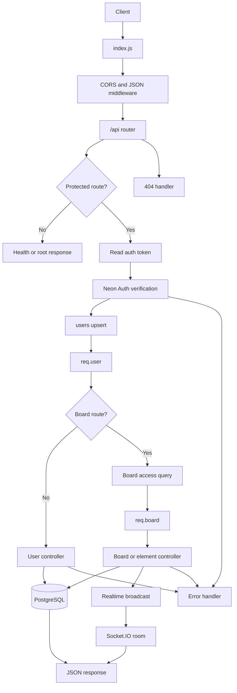
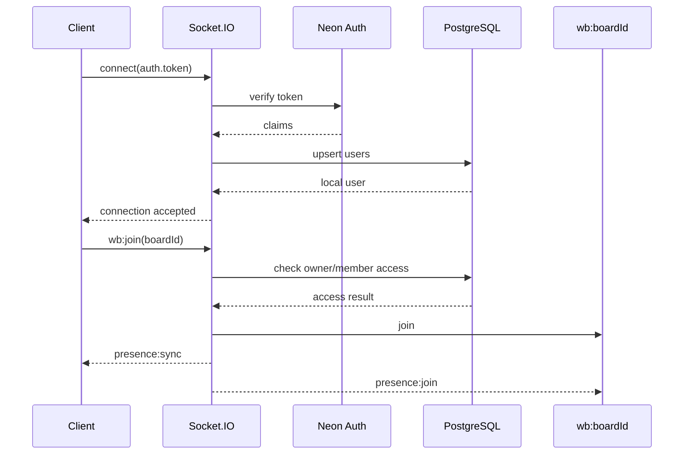

# Server Flow Documentation

This folder documents the current server implementation in detail. It follows the request from HTTP/socket entrypoint through authentication, authorization, database operations, responses, and broadcasts.

## Documents

| Document | Scope |
|---|---|
| [`01-server-and-rest-flow.md`](./01-server-and-rest-flow.md) | Express startup, authentication, middleware, routes, user APIs, board APIs, and error flow |
| [`02-element-flow.md`](./02-element-flow.md) | Element validation, create/update/delete/bulk database flows, responses, broadcasts, and current blocker |
| [`03-realtime-flow.md`](./03-realtime-flow.md) | Socket.IO setup, token authentication, board rooms, presence, cursor, and live element events |
| [`04-database-operations.md`](./04-database-operations.md) | PostgreSQL schema, relationships, indexes, initialization, all SQL operations, cascades, and consistency notes |

## End-to-end HTTP flow



## End-to-end socket flow



## Current implementation note

The Socket.IO server is initialized from [`../index.js`](../index.js) through [`../src/socket/index.js`](../src/socket/index.js). REST mutations use [`../src/realtime/index.js`](../src/realtime/index.js) to broadcast to joined rooms.

There is one known element-flow defect:

```js
query('UPDATE boards SET updated_at = NOW() WHERE id = $1', [boardId])
```

The schema creates `whiteboards`, not `boards`. Consequently, an element insert/update/delete can succeed first and then fail when `touchBoard()` runs, causing the request to return an error and preventing its broadcast. See [`02-element-flow.md`](./02-element-flow.md).
